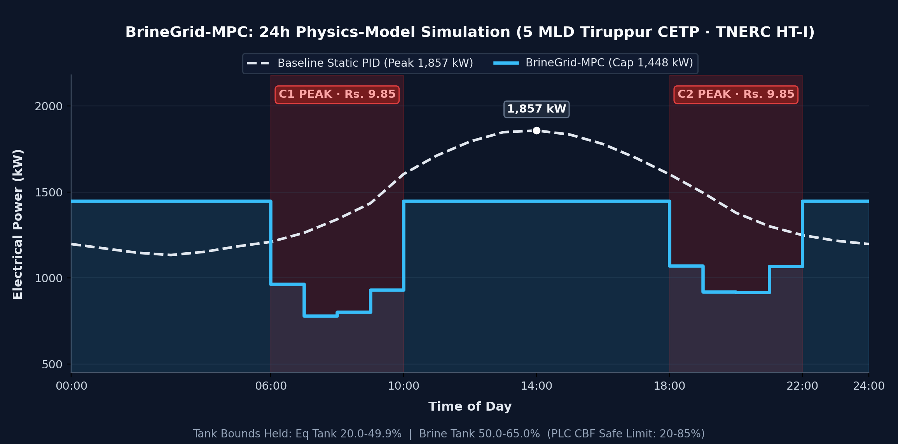

# BrineGrid-MPC — 24-Hour Supervisory Benchmark

**Multi-Agent Hydraulic-Battery & Fouling-Aware Controller for Tamil Nadu Zero Liquid Discharge (ZLD) Plants**  
*K! Hacks 4.0 · Environment & Sustainability Track · Chennai Institute of Technology*



---

## Overview

This repository provides the reproducible **24-hour coupled physics and optimization benchmark** (`brinegrid_sim.py`) for **BrineGrid-MPC**, modeled on a **5 MLD (5,000 m³/day) Tiruppur ZLD Common Effluent Treatment Plant (CETP)** under **TNERC Suo-Motu Tariff Order No. 6 of 2025 (HT-I)**.

Instead of adding new civil storage tanks (**Zero Civil CapEx**), BrineGrid-MPC coordinates three edge supervisory agents over existing plant PLCs to turn existing equalization (`1,800 m³`) and brine buffer (`600 m³`) tanks into a constrained virtual energy battery while strictly enforcing discrete-time **Control Barrier Function (CBF)** safety bounds (`20%–85%` tank levels).

> **Scope Note:** This public repository contains the supervisory plant-level physics model, SLSQP optimizer, and economic calculator for hackathon validation. Proprietary edge PLC register maps, EKF tuning matrices, and low-level hardwired interlock firmware are intentionally excluded.

---

## Reproducible Simulation Results (`brinegrid_sim.py`)

Running `python brinegrid_sim.py` solves the coupled mass-balance, CSTR salinity mixing, RO fouling drift, and TNERC Time-of-Day optimization problem via `scipy.optimize.minimize(..., method="SLSQP")` (converging in `66` iterations):

| Metric | Baseline Static PID (82% RO) | BrineGrid-MPC (85% RO) | Impact |
| :--- | :---: | :---: | :---: |
| **Daily Energy Consumption** | 34.6 MWh/day | 30.6 MWh/day | **-11.5%** |
| **Peak C1 + C2 Grid Draw** | 11,028 kWh/day | 7,456 kWh/day | **-32.4%** |
| **Peak Electrical Power** | 1,857 kW | 1,448 kW | **−22.0%** |
| **Peak Apparent Demand (kVA)** | 2,021 kVA (PF 0.92) | 1,505 kVA (PF 0.96) | **-25.5%** |
| **24h RO Fouling TMP Drift** | +0.63 bar | +0.27 bar | **-56.5%** |
| **RO Reject Brine to MVR** | 900 m³/day | 750 m³/day | **-16.7%** |
| **Equalization Tank Bounds** | Level-locked | 20.0% – 49.9% | Inside `[20–85%]` CBF |
| **Brine Buffer Tank Bounds** | Level-locked | 50.0% – 65.0% | Inside `[20–85%]` CBF |

### Conservative Annualized Economics & Carbon Impact
*(330 operating days/yr, 20% conservative haircut = 80% field realization, annual AMC deducted, CEA v22.0 = 0.675 tCO₂/MWh)*

| Tier | Electricity Saved | Carbon Avoided | Brine Diverted | Net Annual Savings | Turnkey CapEx (+AMC) | Simple Payback |
| :--- | :---: | :---: | :---: | :---: | :---: | :---: |
| **Enterprise (5 MLD CETP)** | 1.05 GWh/yr | 709 tCO₂e/yr | 49,500 kL/yr | **₹144.2 Lakh/yr** | ₹45.0L (+₹5.5L/yr) | **~3.8 months** |
| **MSME (1 MLD IETP)** | 0.21 GWh/yr | 142 tCO₂e/yr | 9,900 kL/yr | **₹27.9 Lakh/yr** | ₹14.5L (+₹2.0L/yr) | **6.2 months** |

---

## Control Formulation

$$\min_{u_t} \sum_{t=0}^{23} \left[ c_{\text{ToD}}(t)\, P_{\text{tot}}(x_t, u_t)\,\Delta t + \lambda_{\text{foul}}\,\frac{dR_f}{dt} \right] + c_{\text{MD}}\,\max_t\!\left(\frac{P_{\text{tot}}(x_t, u_t)}{\text{PF}}\right)$$

subject to periodic hydraulic balance and discrete-time Control Barrier Function (CBF) safety invariance:

$$h_i(x_{t+1}) - h_i(x_t) \ge -\gamma_i\, h_i(x_t), \quad \gamma_i \in (0, 1]$$

ensuring equalization and brine tank levels remain strictly inside `20%–85%`, RO pumps stay inside Best Efficiency Point (BEP) staging limits, and the MVR compressor stays above its anti-surge turndown floor.

---

## Quickstart

```bash
pip install -r requirements.txt
python brinegrid_sim.py
```

Running the script prints the full benchmark table, updates `results/summary_metrics.json`, and regenerates `assets/benchmark_24h.png`.

---

## Repository Structure

```text
brinegrid-mpc/
├── brinegrid_sim.py            # Coupled ZLD physics + SLSQP CBF-MPC benchmark
├── requirements.txt            # Python dependencies (numpy, scipy, matplotlib)
├── assets/
│   └── benchmark_24h.png       # Generated 24h Baseline vs. BrineGrid-MPC plot
├── results/
│   └── summary_metrics.json    # Machine-readable simulation outputs
├── .gitignore
├── LICENSE
└── README.md
```

---

## Regulatory & Technical Anchors

- **Tariff Structure:** TNERC Suo-Motu Tariff Order No. 6 of 2025 (HT-I: ₹9.85/kWh Peak C1/C2, ₹7.48/kWh Night C5, ₹608/kVA/month Max Demand).
- **ZLD Compliance:** TNPCB Circular Memo No. T5/F.6758/2025 (RO/Reject Management System adequacy) & Nov 2025 OCEMS API migration notice.
- **Field Audit:** CAG Tiruppur Angeripalayam CETP Audit (Apr 2026).
- **Policy & Grid Emissions:** MoEFCC CCTS (Jan 2026), TN Circular Economy Investment Policy 2026, and CEA CO₂ Baseline Database v22.0 (0.675 tCO₂/MWh).
- **Control & Water Modeling:** Discrete-time CBF-MPC framework and US DOE WaterTAP unit-model principles.

> *Disclaimer: All performance and ROI figures are derived from a coupled plant-and-tariff physics simulation; live PLC integration and field pilot validation are planned for the next phase.*
